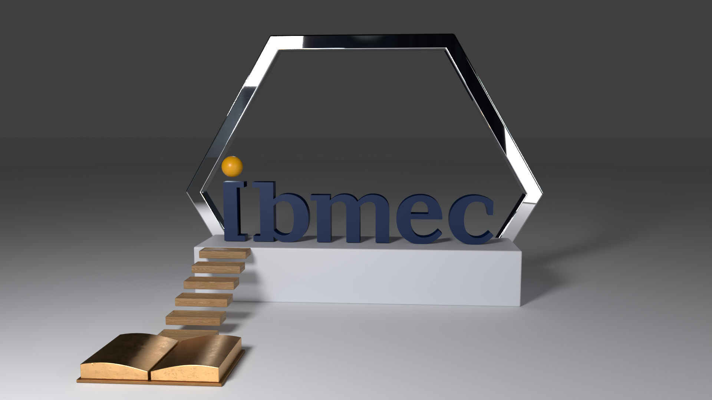
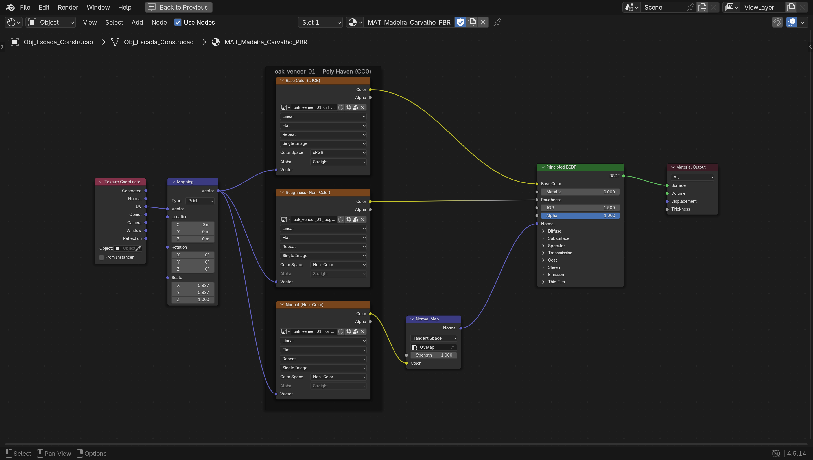
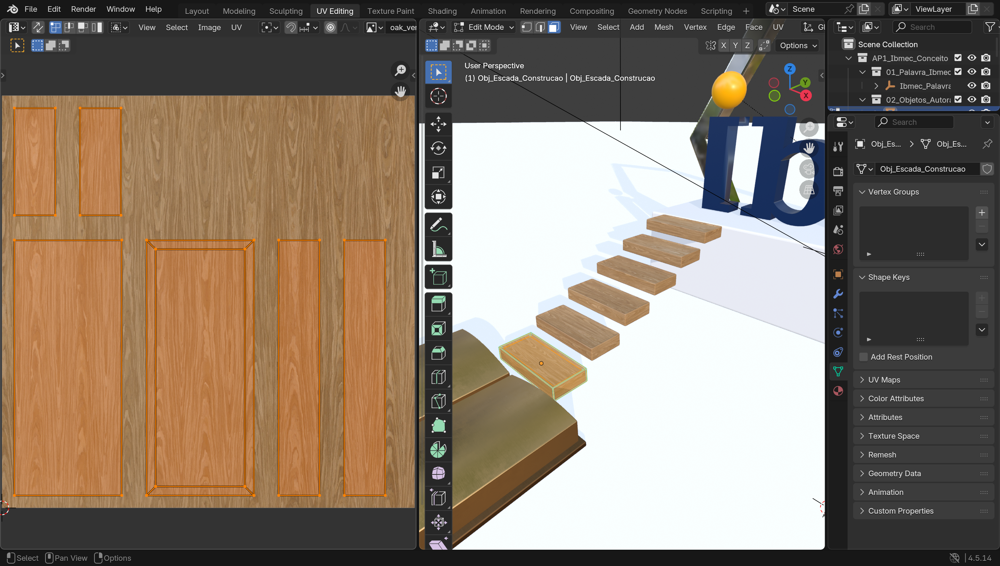
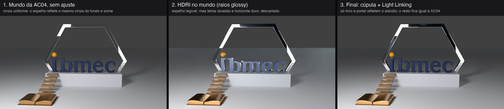

# AC05 — Evolução da Cena: Materiais PBR e Texturas

**Nome:** Rafael Senra Donner Jorge
**Software:** Blender 4.5 LTS (4.5.14), render em Cycles
**Arquivo:** `AC05_RafaelDonner.blend`, cópia da `AC04_RafaelDonner.blend` (AP1 e AC04 não foram alteradas)

Composição, câmera, luzes da AC04 e palavra Ibmec continuam iguais. Os materiais Lambert, Phong e Blinn-Phong foram trocados por materiais PBR no Principled BSDF. O script `AC05_RafaelDonner.py` refaz tudo a partir da AC04.

## 1. Objetos e materiais

| Objeto | Aparência | Material | Motivo |
|---|---|---|---|
| `Obj_Escada_Construcao` | madeira | `MAT_Madeira_Carvalho_PBR` | tábuas de carvalho cru: construção, uma etapa por vez |
| `Obj_Livro_Conhecimento` | metal | `MAT_Bronze_Escovado` (páginas), `MAT_Bronze_Patinado` (capa) | escultura de bronze: a solidez do livro na AP1 |
| `Obj_Portal_Futuro` | espelho | `MAT_Espelho_Polido` | aço polido até virar espelho (referência: *Cloud Gate*) |

| Material | Base Color | Metallic | Roughness | Normal |
|---|---|---|---|---|
| Madeira | mapa `oak_veneer_01_diff` | 0 | mapa `oak_veneer_01_rough` (0,08–0,91) | mapa `nor_gl`, força 1,0 |
| Bronze escovado | `#D9A66B` | 1 | mapa `Metal009_Roughness`, faixa 0,22–0,42 | mapa `Metal009_NormalGL`, força 0,6 |
| Bronze patinado | `#7A5634` | 1 | mesmo mapa, faixa 0,45–0,70 | mesmo mapa, força 0,6 |
| Espelho | `#F2F2F2` | 1 | 0,02 | — |
| Ibmec azul / amarelo | `#002555` / `#F5AC00` | 0 | 0,40 / 0,35 | — |

Metallic 1 só nos metais. A rugosidade controla a nitidez do reflexo: nítido no espelho, borrado no bronze escovado. A palavra Ibmec manteve as cores do SVG oficial, sem textura, relevo ou emissão; só ficou acetinada.

## 2. Mapas e ligações

- **Madeira:** Texture Coordinate (UV) → Mapping → três Image Texture: cor (sRGB) → Base Color; rugosidade (Non-Color) → Roughness; normal (Non-Color) → Normal Map (Tangent Space) → Normal.
- **Bronze** (`03_shader_editor_bronze.png`): só os mapas de dados do Metal009, porque a cor dele é de aço. Rugosidade (Non-Color) → Map Range → Roughness; normal (Non-Color) → Normal Map → Normal. Sem mapa Metallic: o bronze é metal na superfície toda.
- Normais na versão OpenGL, a convenção do Blender. Escala real pelo Mapping: uma repetição do carvalho = 1,83 m; do escovado = 0,6 m.

## 3. UV

- **Escada:** Cube Projection, adequada à forma de caixa dos degraus. As ilhas foram giradas 90° para o veio seguir o comprimento da tábua (girei o UV, e não o Mapping, para não desalinhar o espaço tangente do normal map) e empacotadas sem sobreposição. O Offset UV do Array faz cada degrau ler outro trecho da imagem.
- **Livro** (`05_uv_editor_livro_stretch.png`): a Cube Projection deixava até 2,1% de distorção nas páginas curvas. Com costuras nas arestas vivas e Unwrap (Angle Based), a distorção caiu para 0% (Stretch todo azul). O Offset UV do Mirror evita a mesma marca nas duas páginas.
- **Portal:** sem UV, porque não usa imagem.

## 4. Iluminação

Mantive as duas luzes Area, o mundo cinza 0,05, a câmera e o *Standard* da AC04. Mudanças:

1. **Render em Cycles** (256 amostras, denoise): o espelho precisa de reflexos traçados de verdade.
2. **Cúpula de reflexo** (`Aux_Cupula_Reflexo`, coleção `AC05_Materiais_Texturas`): esfera com o HDRI `studio.exr`, visível só em reflexos e, por Light Linking, só para o livro e o portal.

Com o mundo da AC04, o espelho reflete o mesmo cinza do fundo e some: metal e espelho mostram o que refletem. Um HDRI no mundo resolvia o espelho, mas desbotava a marca (luminância das letras de 0,251 para 0,410) e foi descartado. Com a cúpula, letras e chão ficam a ~2% da AC04.

No Material Preview (`06_material_preview_x_rendered.png`) a cena é iluminada pelo HDRI interno do Blender: chão branco e espelho refletindo árvores. No render valem as luzes da cena. A luz principal, rasante nas faces frontais, revela o escovado do bronze e o veio da madeira (`08_detalhes_100.png`). Os objetos receberam Shade Smooth by Angle com Harden Normals, para os reflexos não ficarem facetados.

## 5. Texturas: origem e licença

| Textura | Fonte | Licença |
|---|---|---|
| `oak_veneer_01` (diff, rough, nor_gl, 1k) | Poly Haven — https://polyhaven.com/a/oak_veneer_01 | CC0 |
| `Metal009` (Roughness, NormalGL, 1K) | ambientCG — https://ambientcg.com/view?id=Metal009 | CC0 |
| `studio.exr` | HDRI que vem com o Blender 4.5 (Poly Haven) | CC0 |

Todas estão empacotadas no `.blend`, com caminhos relativos; a pasta `texturas/` vai junto só para o script. Os materiais da AC04 saíram deste arquivo e continuam na `AC04_RafaelDonner.blend`.
