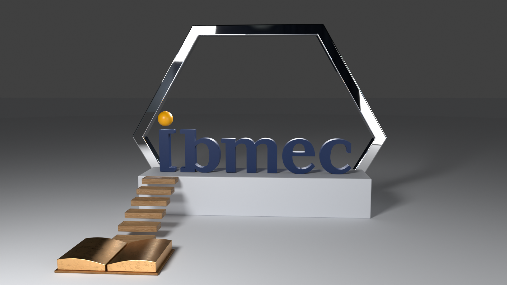
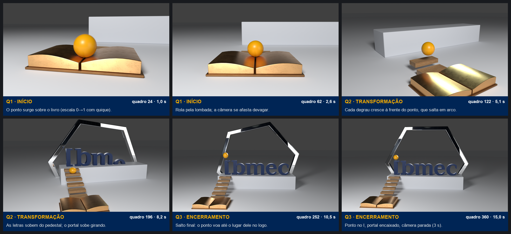
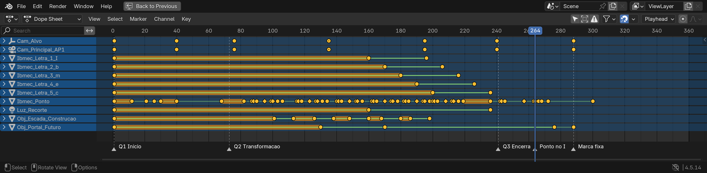
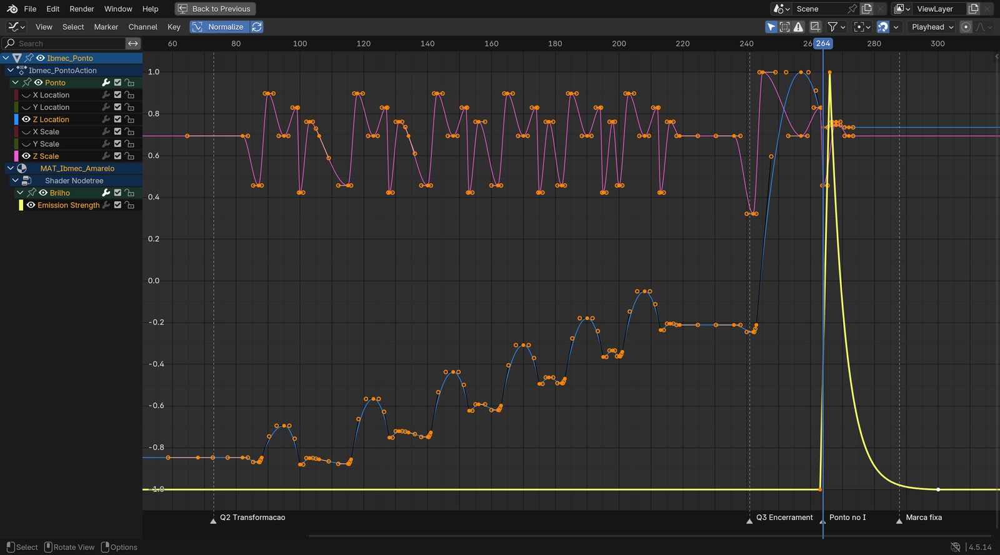

# AP2 — “Ibmec em 15 segundos”: Ponto de Partida

**Nome:** Rafael Senra Donner Jorge
**Software:** Blender 4.5 LTS (4.5.14), render em Cycles
**Arquivos:** `AP2_RafaelDonner.blend` (cópia da AC05; AP1, AC04 e AC05 não foram alteradas), `AP2_RafaelDonner.mp4` (15 s, 24 fps, 1920 × 1080, H.264) e `AP2_RafaelDonner.py`, que refaz a AP2 a partir da AC05

## 1. Conceito e resumo

O conceito da AP1 continua: o ponto amarelo do i é o personagem. Ele é a ideia que nasce no conhecimento (livro), sobe degrau a degrau (escada, construção) e só completa a marca quando chega ao seu lugar, com o portal (futuro) ao fundo. A frase-síntese é *“todo futuro começa num ponto”*.

**Sequência:** o ponto surge sobre o livro de bronze e rola pela lombada. Depois salta para a escada, e cada degrau de carvalho cresce logo à frente dele. As letras sobem do pedestal enquanto o portal espelhado sobe girando. No último salto o ponto pousa sobre o I e acende. A câmera trava no enquadramento da AP1 e a marca fica parada por 3 s.

## 2. Momentos e storyboard atualizado

| Momento | Quadros | Ação | Câmera |
|---|---|---|---|
| Q1 Início | 1–72 (0–3 s) | o ponto surge no livro (12–30) e rola pela lombada (40–68) | perto e baixa no livro; afasta devagar |
| Q2 Transformação | 73–240 (3–10 s) | 6 saltos (88–213), cada degrau crescendo à frente do ponto; letras sobem (160–236); portal sobe (130–276) e gira | sobe em arco pela esquerda, na diagonal da escada (até 135), e vira para a frente (135–240) |
| Q3 Encerramento | 241–360 (10–15 s) | salto final (243) e pouso no I no quadro 264, com brilho; portal encaixa (288) | desacelera e trava no enquadramento da AP1 (288); parada até 360 |

Os três momentos e o pouso no quadro 264 seguem a AP1. Mudanças:

- o ponto salta do livro para o primeiro degrau, em vez de rolar até ele;
- os degraus crescem em vez de aparecer de uma vez;
- os materiais são os da AC05;
- o ponto não gira ao rolar (ver seção 6);
- o render é em Cycles;
- não há áudio.

Marcadores na Timeline: `Q1 Inicio`, `Q2 Transformacao`, `Q3 Encerramento`, `Ponto no I` e `Marca fixa`.

## 3. Propriedades animadas, timing e interpolação

| Elemento | Propriedade | Interpolação | Decisão |
|---|---|---|---|
| `Ibmec_Ponto` | Location X/Y/Z, Scale X/Y/Z | Z: Bezier com alças livres; Y: Linear no ar, Constant parado; escala: Bezier | antecipação (squash), voo em arco (stretch), pouso (squash) |
| `Obj_Escada_Construcao` | entrada `Crescimento` do Geometry Nodes (1 → 6) | Linear nas rampas de 12 quadros, Constant nas pausas | o degrau i cresce de 0 a 1 com overshoot de ~8% (easeOutBack, calculado no próprio grupo de nós) |
| `Ibmec_Letra_1_I` … `5_c` | Location Z (−1,40 m → 0) | QUART Ease Out, 36 quadros, defasagem de 10 | saem rápido do pedestal e assentam devagar, em sobreposição |
| `Obj_Portal_Futuro` | Location Z (−8,2 m → 0), Rotation Y (−60° → 0°) | CUBIC Ease Out (130–276); SINE Ease In-Out (170–288) | o hexágono tem simetria de 60°, então o giro termina encaixado |
| `Cam_Principal_AP1` + `Cam_Alvo` | Location (7 poses) | Bezier Auto Clamped; Auto na pose 135 | sai e chega com velocidade zero |
| `MAT_Ibmec_Amarelo` | Emission Strength 0 → 3 → 0 | Linear na subida (3 q), EXPO Ease Out na queda (34 q) | o ponto acende ao completar o logo e volta à cor da marca |
| `Luz_Recorte` | Power 0 → 900 W | SINE Ease In-Out (160–236) | a luz acompanha a chegada da palavra |

- **Saltos (Z, em azul):** cada salto tem chaves na decolagem, no ápice e no pouso. As alças livres transformam cada metade num arco de parábola exato: o arco fica redondo no ápice e em bico no contato. No ar, o Y é Linear (velocidade horizontal constante). O voo dura 12 quadros, com 7 até o ápice, o que equivale a uma gravidade de ≈10,6 m/s² a 24 fps.
- **Squash & stretch (escala Z, em magenta):** o ponto achata antes de decolar (0,86) e no pouso (0,84), e estica no ar (1,12), mantendo o volume (X·Y·Z ≈ 1). O centro desce junto com o achatamento, para o ponto não flutuar.
- **Ritmo:** o intervalo entre saltos encurta de 28 para 18 quadros, e o ritmo acelera como no storyboard. O salto final tem antecipação maior (0,78).
- **Câmera** (`05_graph_editor_camera.png`): no ponto mais à esquerda do arco, X e Y são extremos, e o Auto Clamped achatava as duas curvas ali. A câmera caía de 0,06 para 0,02 m/quadro e voltava a acelerar. Com alça Auto nessa pose ela passa sem frear. A pose 240, perto do final, deixa a câmera quase parada no pouso do ponto (0,02 m/quadro no 264); ela trava no 288.
- **Letras e portal** (`06_graph_editor_letras_portal.png`): cinco curvas iguais, deslocadas no tempo; o portal começa antes e termina depois, enquadrando a chegada da marca.

## 4. Iluminação e render

Mantive da AC04 a luz principal (1000 W) e a de preenchimento (300 W), o mundo cinza 0,05 e o *Standard*, que preserva as cores da marca. Da AC05 ficou a cúpula de reflexo: sem ela o espelho e o bronze somem no fundo cinza. A novidade é a `Luz_Recorte`, a rim light planejada na AP1: uma Area de 4 × 1,5 m atrás do portal, apontada para a palavra.

- **Light Linking:** só as letras e o ponto recebem a `Luz_Recorte`. Testei três versões (`imagens/AP2_RafaelDonner_07_teste_luz_recorte.png`). Sem linking, ela clareava o chão e abria faixas de luz pelo portal. Ligada só à palavra, ela desenha o contorno de cima das letras e as separa do fundo, sem mudar o azul das faces.
- **Shadow Linking:** só a própria palavra bloqueia a luz, então o portal subindo e girando não projeta sombras móveis nas letras.
- **Luz contando a história:** a rim light acende enquanto as letras sobem, e o ponto brilha ao pousar.

**Render:** Cycles na GPU (Metal, Apple M4), 1920 × 1080, 24 fps, quadros 1–360.

- 128 amostras adaptativas com denoise OIDN.
- Motion blur (obturador 0,5) e semente fixa, para os 3 s finais não cintilarem.
- 1 h 37 min para os 360 quadros (≈16 s por quadro).

Antes do final, renderizei a sequência inteira em 480 × 270 com 16 amostras e quadros-chave em resolução cheia. O vídeo saiu de uma sequência PNG (retomável se travar), montada em MP4 H.264 com o FFmpeg (yuv420p, BT.709). O `.blend` também está configurado para gerar o MP4 direto pelo *Render Animation*. Conferi o MP4 (5 MB): 360 quadros em 15,0 s, diferença média para os PNG abaixo de 1/255, cores da marca preservadas e os 3 s finais parados.

Fiquei no Cycles, e não no Eevee, porque a cúpula da AC05 depende de visibilidade por tipo de raio e de Light Linking. Esses recursos sustentam o espelho e o bronze, e o M4 renderizou a sequência em 1 h 37 min.

## 5. Materiais e texturas (AC05)

Os materiais da AC05 foram mantidos, todos Principled BSDF. Ele é um modelo baseado em princípios físicos, não uma implementação de Phong ou Blinn-Phong.

- **Escada:** `MAT_Madeira_Carvalho_PBR` (oak_veneer_01). Os mapas são cor (sRGB), rugosidade (Non-Color) e normal (Non-Color → nó *Normal Map*). O crescimento escala a geometria junto com o UV, então o veio cresce com a tábua, sem deslizar nem esticar.
- **Livro:** `MAT_Bronze_Escovado` e `MAT_Bronze_Patinado` (mapas de dados do Metal009). Conferi no close de abertura, com a câmera a ~2,8 m: não aparecem repetição nem distorção.
- **Portal:** `MAT_Espelho_Polido`. Ao subir e girar, o reflexo da cúpula muda, e isso é intencional.
- **Palavra:** `MAT_Ibmec_Azul` (#002555), sem alteração e compartilhado pelas cinco letras. `MAT_Ibmec_Amarelo` (#F5AC00) ganhou só a emissão animada, na mesma cor, que volta a 0 no quadro 300.

As 6 imagens estão empacotadas no `.blend`, com caminhos relativos (`//../AC05/texturas/`).

## 6. Desafios e soluções

- **A palavra era uma malha só.** Separei as faces por faixa de X em cinco objetos, com origem na base, o mesmo Empty pai e o mesmo Bevel. O quadro 360 sem a luz nova bate com o render da AC05: diferença média de 0,9/255, só ruído.
- **O Count do Array é inteiro, e o degrau aparecia de uma vez.** Coloquei um grupo de Geometry Nodes entre o Array e o Bevel. Ele lê o índice do degrau pela posição e escala cada degrau em torno do próprio centro. A escala mínima de 0,001 mantém a topologia constante, e o motion blur continua funcionando.
- **O ponto raspava a borda do degrau.** Rolando do livro para o degrau, ele atravessava a borda de 2 cm do piso rebaixado, e a solução foi um salto. Um script mede a cada ¼ de quadro a distância do ponto (como elipsoide) à escada, ao livro, ao pedestal e às letras. Também confere se ele fica no quadro e sem nada na frente. Resultado: nenhuma penetração na escada e 1,7 mm no squash sobre o livro.
- **Com o ritmo acelerando, as poses de pouso e de antecipação se sobrepunham.** O rebote e o repouso só entram quando cabem antes do salto seguinte.
- **O rolamento não aparecia.** Numa esfera lisa de cor única a rotação de rolar não aparece; troquei por squash & stretch, que se vê.

## 7. Fontes e licenças

| Recurso | Fonte | Licença |
|---|---|---|
| `oak_veneer_01` (diff, rough, nor_gl, 1k) | Poly Haven — https://polyhaven.com/a/oak_veneer_01 | CC0 |
| `Metal009` (Roughness, NormalGL, 1K) | ambientCG — https://ambientcg.com/view?id=Metal009 | CC0 |
| `studio.exr` | HDRI que vem com o Blender 4.5 (Poly Haven) | CC0 |
| Logotipo Ibmec (SVG) | site oficial ibmec.br, importado na AP1 | marca do Ibmec, usada neste trabalho acadêmico |

A peça não tem áudio. Ferramentas: Blender 4.5.14 LTS e FFmpeg (libx264).
